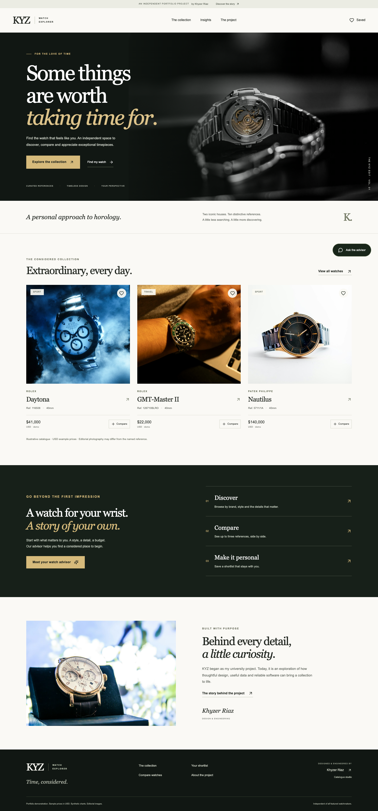
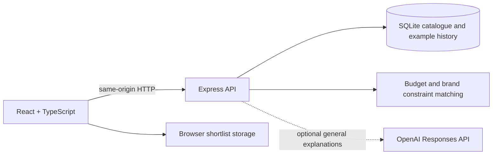

# KYZ — Watch Explorer

A watch discovery and comparison application by **Khyzer Riaz**, developed from an earlier university project. It combines a React and TypeScript interface with an Express API, a persistent SQLite catalogue, a constraint-based advisor and transparent demonstration analytics.



[](https://github.com/KhyzerRiaz24/kyz-watch-explorer/actions/workflows/ci.yml)

[Live demo](https://kyz-watch-explorer.onrender.com) · [GitHub repository](https://github.com/KhyzerRiaz24/kyz-watch-explorer)

The free public demo uses the built-in advisor and a read-only catalogue. The optional live AI and protected editor remain available in a privately configured deployment.

## Explore

- Browse ten original watch references; search by name, brand, reference or feature.
- Filter by watchmaker, style and USD budget; sort by price or name. Filters stay in the URL.
- Save a personal shortlist in browser storage and compare up to three watches with shareable links.
- Inspect specifications in keyboard-accessible dialogs, with clearly labelled synthetic price charts and accessible data tables.
- Ask one advisor for catalogue recommendations or general watch explanations. Brand and budget constraints are enforced before ranking results.
- Review SQL-derived collection statistics and export the illustrative catalogue as CSV.
- Create, update and delete references through a protected catalogue studio.

This is an **independent portfolio demonstration**, not a retailer or investment service. Prices, specifications and charts are illustrative. Images are editorial and may not depict the named reference. KYZ is not affiliated with any featured watchmaker.

## Run locally

Use **Node.js 24 LTS** (recommended), or Node.js **22.13+**. The built-in SQLite API may emit an experimental warning on Node 22. No separate database service is needed.

```sh
npm ci
npm run setup
npm run dev
```

Open **http://127.0.0.1:4177**. The first start creates and seeds `data/kyz.sqlite`. Restarting preserves edits; an intentionally emptied catalogue is not silently reseeded. The original university submission is not required to run this copy.

The app works without an external API key. `npm run setup` creates an ignored `.env` with a cryptographically generated private studio key; it preserves existing configuration. Run `npm run admin-key` privately to view that key, then open `/studio`. The key grants catalogue editing access: never put it in a screenshot or commit it.

### Production

```sh
npm run build
npm start
```

The Express server serves both the compiled frontend and API. Do not deploy only `dist/` to static hosting: the application requires its Node server and persistent database. See [deployment instructions](docs/DEPLOYMENT.md) for Docker and backup procedures.

## Configuration

Copy or generate `.env` from `.env.example`. All values are server-side. Never use a `VITE_` prefix for secrets.

- `PORT`: defaults to `4177`.
- `HOST`: defaults to `127.0.0.1`; containers bind to `0.0.0.0`.
- `DATABASE_PATH`: defaults to `data/kyz.sqlite`, relative to the project root.
- `ADMIN_TOKEN`: enables the protected studio. An empty value disables editing.
- `OPENAI_API_KEY` and `OPENAI_MODEL`: both are required to enable optional AI explanations. Choose a model available to your API account that supports the Responses API. API usage can incur charges.
- `TRUST_PROXY`: use `1` only behind exactly one trusted reverse proxy; otherwise leave it `0`.

### Advisor behaviour

Catalogue queries are handled deterministically and never require AI. Examples: `Rolex under $25k`, `between $15,000 and $30,000`, `Patek under $100k`, `a diving watch under $20k`.

The advisor recognises a documented set of budget phrases, styles and features; it is not an unrestricted natural-language reasoning engine. It treats supported upper limits as inclusive. It does not infer currency conversions or maintain preference memory across turns. Follow-up requests should restate the required constraints. Results can be empty; constraints are never relaxed silently.

When both OpenAI settings are configured, general educational questions may use the server-side Responses API. Requests have time and output limits, response storage is disabled, and provider errors return a labelled built-in fallback. Product matching remains deterministic even in AI mode. This is **AI integration and rule-based recommendation**, not a trained ML model. No live paid API call is needed for the test suite: provider success and failure are tested with controlled responses.

## Verify

```sh
npm run check
npx playwright install chromium
npm run test:e2e
npm audit --audit-level=moderate
```

`check` runs TypeScript checks, lint, server tests and the production build. Browser tests start an isolated production server on port `4181`, use their own database and generate a temporary studio key. Run the production build before invoking browser tests on their own.

For an installed Chrome browser, set `PLAYWRIGHT_CHROMIUM_EXECUTABLE_PATH` to its executable instead of downloading Chromium. See [verification notes](docs/VERIFICATION.md).

## Architecture



- `src/`: interface, client state, accessible components and pages.
- `server/`: routing, input validation, database access, advisor and startup.
- `shared/catalogue.json`: sanitised original example catalogue.
- `tests/`: database persistence, API, security and recommendation regression tests.
- `e2e/`: browser workflows, responsive checks and automated accessibility scans.
- `.github/workflows/ci.yml`: checks, audit, browser tests and production container build on pushes and pull requests.

[Engineering decisions](docs/ENGINEERING.md) explain the database migration, security boundaries and trade-offs. [Data methodology](docs/DATA.md) explains exactly what the analytics represent. [Portfolio material](docs/PORTFOLIO.md) includes a LinkedIn description and a practical demo walkthrough.

## From the original project

The original KYZ JEWELLERS identity, ten watch references and editorial image sources are retained. The application was reworked to replace browser-exposed credentials, disconnected catalogue data, inconsistent assistants, budget-matching errors, repeated mock charts and mobile layout problems. Implementation and review used AI assistance; this repository records the design decisions, limitations and tests so its behaviour can be explained and reproduced.

The original submission contained previously exposed credentials. The old OpenAI key was verified as revoked in the provider console, and the owner confirmed deletion of the old MongoDB cluster. The replacement OpenAI key is configured privately for the local deployment; no old or new secret values or environment files are included in this repository. Keep the original submission private and publish this sanitised project copy.

## Boundaries

Saved watches are local to one browser, not accounts or cloud-synchronised favourites. The studio is a small single-curator interface with an in-memory bearer key, not a multi-user identity system. SQLite is appropriate for a small single-instance portfolio; it is not a horizontally scaled architecture. AI explanations can be wrong, sample data is not market evidence, and automated accessibility scans complement manual review rather than proving universal compliance.

See [image credits](docs/CREDITS.md). Watch brand names and marks belong to their respective owners. No open-source licence is granted for this project by default; third-party dependencies and photographs retain their own licences.
